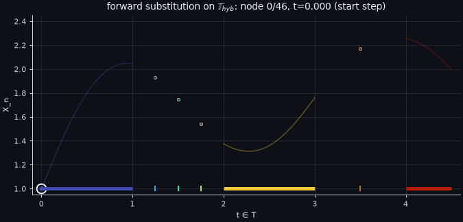
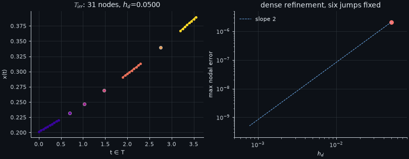
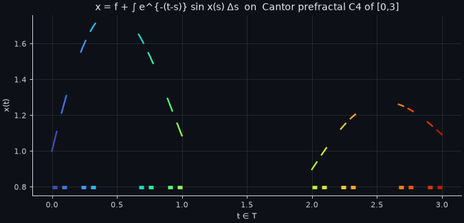
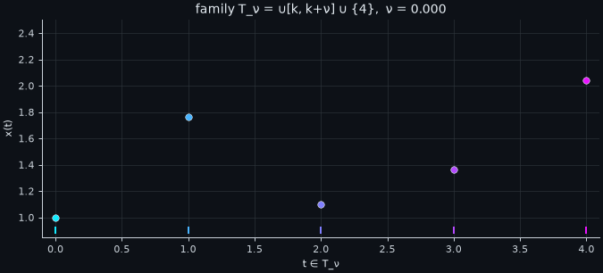
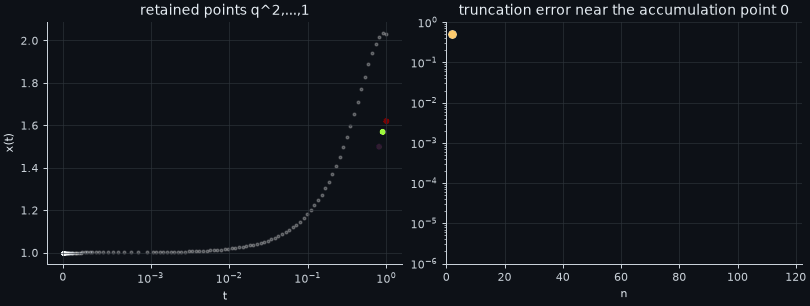
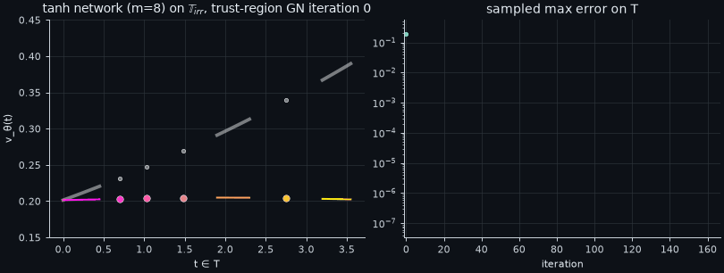

<p align="center"></p>

<p align="center">
<a href="https://www.python.org/"></a>
<a href="LICENSE"></a>
<a href="https://github.com/Khuddush89/TimeScale-Volterra-Nystrom/actions/workflows/tests.yml"></a>


</p>

# 🕰️ TimeScale-Volterra-Nystrom

Code, data and figures for the paper

> **Mahammad Khuddush** (sole author), *A gap-aware trapezoidal Nyström method with two-sided residual bounds for nonlinear Volterra integral equations on time scales* (manuscript, 2026).

Every number, table, figure and animation in this repository was produced by the scripts here, on the machine described in [Reproducibility](#-reproducibility). Nothing is synthetic.

## 🔭 Overview

A **time scale** $\mathbb T$ is a nonempty closed subset of $\mathbb R$: an interval, $h\mathbb Z$, $q^{\mathbb N_0}\cup\{0\}$, a Cantor prefractal, or any mixture of these. We solve

$$
x(t)=f(t)+\int_a^t K\bigl(t,s,x(s)\bigr)\,\Delta s,\qquad t\in[a,b]_{\mathbb T},
$$

where $\Delta s$ is the Hilger delta integral. With forward jump $\sigma(t)=\inf\{s\in\mathbb T:s>t\}$ and graininess $\mu(t)=\sigma(t)-t$, the delta integral over a scale with finitely many gaps splits into Riemann integrals over the intervals plus point masses at the right-scattered points:

$$
\int_s^t F(\tau)\,\Delta\tau=\int_{[s,t]\cap D}F(\tau)\,d\tau+\sum_{s\le q_i<t}\mu(q_i)\,F(q_i).
$$

The classical case is $\mathbb T=\mathbb R$ ($\mu\equiv0$). The purely discrete case $\mathbb T=h\mathbb Z$ is the recursion $x(t)=f(t)+\sum_{s\in h\mathbb Z,\ a\le s<t}hK(t,s,x(s))$.

**What the package provides.**

* ⚙️ **Delta trapezoidal rule.** It has a constant-sign Peano kernel and the closed-form constant
  $\kappa=\dfrac{H^3}{12}-\dfrac{S_3}{3}+\dfrac{S_2^2}{4H}$, where $S_k=\sum_i g_i^k$ is the sum of the $k$-th powers of the gap lengths in a step. The constant is $0$ on a scattered step.
* 🧮 **Gap-conforming Nyström method.** It is solvable when $\gamma=\max_n w^+_{n-1}\ell^-(t_n,t_n)<1$, a condition on the dense steps only. Stability is controlled by a discrete majorant $\bar U_N$. The order is two in the dense step and four after Richardson extrapolation. The method is exact on full discrete partitions.
* 📐 **Two-sided residual bound for any trial function $v$.**

$$
\frac{|r_v(t)|}{1+\Lambda(t)}\le\sup_{s\le t}|v(s)-x(s)|,\qquad |v(t)-x(t)|\le\Gamma(t)\sup_{s\le t}|r_v(s)|.
$$

* 🧠 **Neural trial functions** (MLP, graininess-aware MLP-TS, random features, Chebyshev). They are compared honestly with the classical solvers, which win on the benchmark.
* 🌀 **Unusual time scales**: Cantor prefractals, $P_{\alpha,\beta}$, random unions, the harmonic numbers, $\sqrt{\mathbb N_0}$, and $q^{\mathbb N_0}\cup\{0\}$ with an accumulation point.

## 🎞️ Animations (computed, not drawn)

| | |
|:--:|:--:|
| <br>Forward substitution on $\mathbb T_{\rm hyb}$: implicit dense steps and explicit gap steps | <br>Dense refinement on $\mathbb T_{\rm irr}$ with six jumps fixed: slope 2 |
| <br>Solutions on six unusual time scales | <br>$\mathbb T_\nu=\bigcup_k[k,k+\nu]\cup\{4\}$ from discrete ($\nu=0$) to $[0,4]$ ($\nu=1$) |
| <br>$0.9^{\mathbb N_0}\cup\{0\}$: truncation error decays like $q^n$ | <br>A tanh network trained on the delta-integral residual on $\mathbb T_{\rm irr}$ |

In every plot, curves are drawn only on the intervals of $\mathbb T$, isolated points are markers, and nothing is drawn across a gap.

## 📦 Installation

```bash
git clone https://github.com/Khuddush89/TimeScale-Volterra-Nystrom.git
cd TimeScale-Volterra-Nystrom
python -m venv .venv && source .venv/bin/activate
pip install -r requirements.txt        # exact paper environment: needs Python 3.13 (NumPy 2.5.4 / SciPy 1.18.1 require Python >= 3.12)
# or: pip install -r requirements-min.txt  # minimal ranges used by the CI matrix (Python 3.11 and 3.13)
# or: pip install -e ".[experiments]"
```

## 🚀 Quickstart

```bash
python -m tsvolterra.cli scales                                   # list built-in time scales
python -m tsvolterra.cli info  --scale irr                        # components, sigma, mu
python -m tsvolterra.cli solve --scale hybrid --h 0.0625 --manufactured --plot hybrid.png
python -m tsvolterra.cli solve --scale harmonic                   # discrete: exact recursion
python -m tsvolterra.cli solve --scale qacc --n 160               # accumulation point + truncation bound
python -m tsvolterra.cli converge --scale cantor --levels 5       # observed order 2.00
```

```python
import numpy as np
from tsvolterra import scales, nystrom
from tsvolterra.timescale import Partition
from tsvolterra.problems import VolterraProblem, kernel_exp_sin

T = scales.cantor(4)                                   # 16 intervals, 15 shrinking gaps
K, Kx, L = kernel_exp_sin(1.0, 1.0)                    # K = exp(-(t-s)) sin x
prob = VolterraProblem(T, K, Kx, L, f=lambda t: 1 + 0.5*np.sin(2*np.asarray(t)))
P = Partition.gap_conforming(T, h=2**-6)               # contains every gap endpoint
X = nystrom.solve(prob, P)                             # forward substitution
U = nystrom.majorant_stability(P, lambda t, s: np.exp(-(np.asarray(t)-np.asarray(s))))
print(P.N + 1, "nodes, x(b) =", X[-1], " stability constant =", U[-1])
```

## 🔁 Reproduce every table and figure

The run times below are **measured** single end-to-end runs on an 8-core Intel Xeon (no GPU, Debian 13, Python 3.13.5). The P5 benchmark scripts were run serially without other jobs; `exp5_family` (236 s) was run while an earlier benchmark run shared the cores, so its time is indicative.

| Paper item | Command (from repo root) | Output | Time |
|---|---|---|---|
| Fig. 1 (quadrature) | `python experiments/exp2_quadrature.py && python experiments/plot_paper_figures.py` | `results/exp2_quadrature.json`, `figures/fig_quadrature.*` | 2.0 s + 4.8 s |
| Table 1, Table 2, Fig. 2 | `python experiments/exp3_convergence.py` | `results/exp3_convergence.json` | 7.8 s |
| Table 3, Fig. 3 (P5 benchmark, saves checkpoints) | `python experiments/exp4_benchmark.py all && python experiments/exp4_lm.py` | `results/exp4_*.json`, `results/checkpoints/*.npz` | 358.1 s + 108.5 s |
| Table 3 grid-method times | `python experiments/exp4_timing_controlled.py` | `results/exp4_timing_controlled.json`, `results/csv/timing_controlled_P5.csv` | 6.5 s |
| Re-evaluate all 58 checkpoints (no retraining) | `python experiments/evaluate_checkpoints.py` | `results/csv/checkpoint_reevaluation.csv` | 43.3 s |
| Profiles from checkpoints, Fig. 3 | `python experiments/exp4_profiles.py && python experiments/plot_exp4.py` | `results/exp4_profiles.json`, `figures/fig_pareto.*` | 29.8 s + 3.3 s |
| Fig. 4 (overfitting) | `python experiments/exp4_overfit.py` | `results/exp4_overfit.json` | 16.7 s |
| Fig. 5 (family $\mathbb T_\nu$) | `python experiments/exp5_family.py` | `results/exp5_family.json` | 236 s |
| Table 4, Fig. 6 ($\mathbb T_{\rm irr}$) | `python experiments/revision_checks.py && python experiments/revision_neural.py` | `results/revision_*.json` | 4.6 s + 2.8 s |
| Table 5, Figs. 7–8 (unusual scales) | `python experiments/exp7_unusual.py && python experiments/plot_new_figures.py` | `results/exp7_unusual.json` | 1.4 s + 3.5 s |
| Table 6, Fig. 9 (noise 0/1/5/10 %) | `python verification/verify_independent.py` | `results/verification.json` | 5.9 s |
| Table 5 bottom block, 70-digit truncation check | `python verification/qacc_highprec.py` | `results/qacc_highprec.json`, `results/csv/qacc_highprec.csv` | 0.1 s |
| All CSVs and LaTeX tables | `python experiments/aggregate_benchmark.py && python experiments/export_tables.py` | `results/csv/*.csv`, `tables/*.tex` | < 1 s |
| GIFs | `python experiments/make_gifs.py` | `assets/gifs/*.gif` | about 96 s |
| Unit tests | `python -m unittest discover -s tests -v` | 16 tests | 4.2 s |

Deterministic results agree to the reported accuracy across our reruns. Neural optimisation and timings may vary with the software environment and threading: two Adam+L-BFGS medians of an earlier run were not reproduced (see the paper, Sec. 9), whereas two later reruns on the same machine agreed in all 50 neural runs. **Trained models are retained:** the final parameters of every P5 network are in `results/checkpoints/` (architecture, seed, random-feature parameters, loss and optimiser configuration); load one with `tsvolterra.checkpoints.load(path, T, xa)`.

## 📊 Results at a glance

**Dense refinement on unusual hybrid scales** (`results/csv/table_unusual_scales.csv`)

| scale | gaps | nodes | max error | EOC | Richardson (best) |
|---|---:|---:|---:|---:|---:|
| Cantor prefractal $\mathbb C_4$ | 15 (sizes $1,\tfrac13,\tfrac19,\tfrac1{27}$) | 32 → 1040 | 5.87e-5 → 1.43e-8 | 2.00 | 1.3e-14 |
| $P_{0.3,0.2}$ | 5 | 12 → 390 | 7.67e-3 → 1.82e-6 | 2.00 | 8.7e-11 |
| random union $\mathbb T_{\rm rnd}$ | 10 | 17 → 395 | 3.32e-2 → 6.99e-6 | 2.00 | 9.3e-10 |

**Accumulation point** $0.9^{\mathbb N_0}\cup\{0\}$: with $n=10,20,40,80,160,320$ retained points, the truncation errors computed in 70-digit arithmetic are $0.278,\,0.102,\,1.24\text{e-}2,\,1.84\text{e-}4,\,4.02\text{e-}8,\,1.92\text{e-}15$ (double precision: $2.0\text{e-}15$ at $n=320$, the roundoff floor). All lie below the proved bound $q^n\prod_j(1+\mu_j)$; the ratio error/bound is 0.317–0.425.

**Benchmark (P5) on $\mathbb T_{\rm hyb}$**: median errors over 5 seeds; network times are training times (mean ± std, serial runs) (`results/csv/table_benchmark_summary.csv`)

| method | parameters | error | time [s] |
|---|---:|---:|---:|
| Nyström $h=2^{-7}$ (nodal; median of 7 timings) | – | 3.59e-6 | 0.0054 |
| Richardson $h=2^{-7}$ (nodal; median of 7 timings) | – | 1.81e-11 | 0.019 |
| TS-spectral degree 20 | 67 | 4.66e-15 | 0.29 |
| MLP-TS $2\times16$, Adam+LM | 337 | 2.19e-5 | 9.6 ± 0.2 |
| random features $m=256$, LM | 257 | 1.23e-4 | 0.32 ± 0.02 |
| MLP $3\times32$, Adam+L-BFGS | 2209 | 1.88e-4 | 13.2 ± 4.5 |

**Noise on the data** ($\mathbb T_{\rm irr}$, 10 seeds per level): Gaussian perturbations with relative standard deviations 0, 1, 5 and 10 % give relative nodal $\ell^2$ errors 2.0e-7, 6.2e-3, 3.1e-2 and 6.2e-2. The largest observed ratio of the deviation to $\bar U_N\|\delta\|_\infty$ is 0.445, so all tested runs satisfy the stability estimate.

## 🖼️ Figures

| | |
|:--:|:--:|
|  |  |
|  |  |
|  |  |
|  |  |

## 🗂️ Project tree

```
TimeScale-Volterra-Nystrom/
├── tsvolterra/            # package: time scales, delta quadrature, Nyström, residual bounds, networks, CLI
│   ├── timescale.py       #   TimeScale (σ, μ, h2, h3, e_p), gap-conforming Partition
│   ├── quadrature.py      #   delta trapezoid weights, Peano constant κ
│   ├── nystrom.py         #   forward substitution, Picard, Richardson, discrete majorant
│   ├── certify.py         #   two-sided residual indicators
│   ├── checkpoints.py     #   save/load trained trial functions (P5 checkpoints)
│   ├── neural.py          #   MLP / MLP-TS / random features / Chebyshev, Adam, L-BFGS, LM
│   ├── problems.py        #   kernels and the test scales of the paper
│   ├── scales.py          #   Cantor, P_ab, random, harmonic, sqrt(N0), q^N0 ∪ {0}
│   ├── tsplot.py          #   gap-respecting plotting (never draws across a gap)
│   └── cli.py             #   python -m tsvolterra.cli ...
├── experiments/           # one script per table / figure (see table above)
├── verification/          # independent re-implementation (does not import tsvolterra) + noise test; 70-digit truncation check
├── tests/                 # unit tests (16; incl. reload of all 58 checkpoints)
├── results/               # raw JSON results, results/csv/ (one CSV per table and figure), results/checkpoints/ (58 trained P5 models)
├── assets/                # banner, GIFs, PNG figures used in this README
├── .github/workflows/     # CI: tests, CLI smoke test, verification
├── requirements.txt       # exact versions; requirements-min.txt for CI
├── CITATION.cff  LICENSE  pyproject.toml
```

## 🔬 Reproducibility

* **Hardware.** Intel Xeon Processor, 8 cores (1 thread/core), 15 GiB RAM, no GPU.
* **Software.** Debian GNU/Linux 13, kernel 6.12, Python 3.13.5, NumPy 2.5.4, SciPy 1.18.1, JAX 0.11.2 (x64), Matplotlib 3.11.2, SymPy 1.14.0, pandas 3.0.6.
* **Seeds.** Networks use seeds 0–4 (`jax.random.PRNGKey`), and 0–2 for LM from the random initialisation. The family network uses seed 7, the random scale seed 2026, and the noise test seeds 1000–1009.
* **Independent checks.** `verification/verify_independent.py` checks Tables 1, 2 and 4 and the noise experiment; `verification/qacc_highprec.py` checks the truncation study in 70-digit arithmetic. Neural training, the other unusual-scale studies and the timings are not independently re-implemented.
* **Precision.** All runs use float64. Sampled residual quantities are *indicators*. Validated bounds need the enclosures described in the paper (Proposition 5.10).

## 👤 Author

**Mahammad Khuddush** (sole author) · ORCID [0000-0002-1236-8334](https://orcid.org/0000-0002-1236-8334) · khuddush89@gmail.com
Department of Mathematics, Vignan's Institute of Information Technology (Autonomous), Visakhapatnam, India; School of Sciences, Woxsen University, Hyderabad, India.

## 📝 Citation

```bibtex
@unpublished{Khuddush2026TimeScaleVolterra,
  author = {Khuddush, Mahammad},
  title  = {A gap-aware trapezoidal {N}ystr{\"o}m method with two-sided residual bounds for
            nonlinear {V}olterra integral equations on time scales},
  note   = {Manuscript. Code: https://github.com/Khuddush89/TimeScale-Volterra-Nystrom},
  year   = {2026}
}
```

Licensed under the [MIT License](LICENSE).
